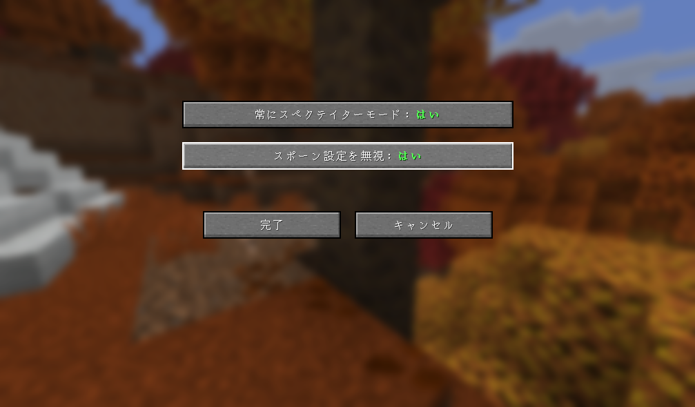

# Easy Spectator

  

  <strong>死亡リスポーン時に自動でスペクテイター化する軽量 Mod</strong> 
  Minecraft 26.3 対応 / Fabric & NeoForge マルチローダー

  <a href="README.md">English</a> | <strong>日本語</strong>

---

**Easy Spectator** は、プレイヤーが死亡してリスポーンした際に、自動的にゲームモードを **スペクテイターモード (`SPECTATOR`)** に切り替える軽量な Minecraft Mod です。

デスしたら即座に観戦者となるサバイバル企画やハードコア風イベント、マルチプレイサーバー（SMP）でのミニゲームなどに最適です。外部設定ライブラリ（Cloth Config など）を一切必要とせず、バニラ標準の軽快で分かりやすいゲーム内設定画面を備えています。

## 🌟 主な機能

- 👻 **死亡リスポーン時に自動スペクテイター化**
  - プレイヤーが死亡して「リスポーン」ボタンを押した際（`keepEverything == false`）、自動的にゲームモードを `SPECTATOR` へ切り替えます。
  - ※ エンダードラゴン討伐後の帰還ポータル通過など、生存した状態でのリスポーン・移動（`keepEverything == true`）では発動しません。サバイバルのまま拠点ベッドへ安全に帰還できます。
- 📍 **ベッド／リスポーンアンカーの自動解除（初期スポーン帰還）**
  - 死亡リスポーン時にベッドやリスポーンアンカーの個人登録を自動クリアし、オーバーワールドの初期スポーン地点へ安全にリスポーンさせます。
  - 設定で無効化すれば、登録済みのベッド位置にスペクテイターとしてリスポーンさせることも可能です。
- ⚙️ **外部ライブラリ不要のゲーム内設定画面 (GUI)**
  - バニラ標準の UI ウィジェットで構築されており、追加のライブラリ MOD を導入することなくゲーム内で設定を変更できます。
  - Fabric では **ModMenu**、NeoForge では **Mods メニューの「Config」ボタン** から開くことができます。
  - 有効・無効の状態がひと目でわかるカラー表示（**はい (Yes)** は緑色太字、**いいえ (No)** は赤色太字）を採用しています。

## 📸 スクリーンショット

## ⚙️ 設定項目 (Configuration)

ゲーム内の設定画面、または設定ファイル（`config/mc_easy_spectator.properties`）からいつでも変更できます。

| GUI 表示名 | 設定ファイル項目 | 型 | 初期値 | 説明 |
| :--- | :--- | :--- | :--- | :--- |
| **常にスペクテイターモード** | `enabled` | `boolean` | `true` | **はい (Yes)**: 死亡リスポーン時にスペクテイターモードへ変更します。 **いいえ (No)**: Mod 機能を一時的に無効化します。 |
| **スポーン設定を無視** | `ignoreSpawnPoint` | `boolean` | `true` | **はい (Yes)**: ベッド等の登録を解除し、ワールド初期スポーン地点へリスポーンします。 **いいえ (No)**: ベッドやアンカーの登録位置へリスポーンします。 |

## 📥 動作要件・導入方法

- **対応 Minecraft バージョン**: 26.3
- **対応ローダー**:
  - **Fabric**: Fabric Loader 0.19.3+ / Fabric API（ゲーム内設定画面の利用には ModMenu 推奨）
  - **NeoForge**: NeoForge 26.3.0.3-beta+
- **動作環境**: シングルプレイ / マルチプレイサーバー両対応
  - 専用サーバーに導入することで、接続しているすべてのプレイヤーに対して死亡時のスペクテイター化が自動適用されます。

## 📄 ライセンス

本プロジェクトは [MIT License](https://opensource.org/licenses/MIT) のもとで公開されています。
