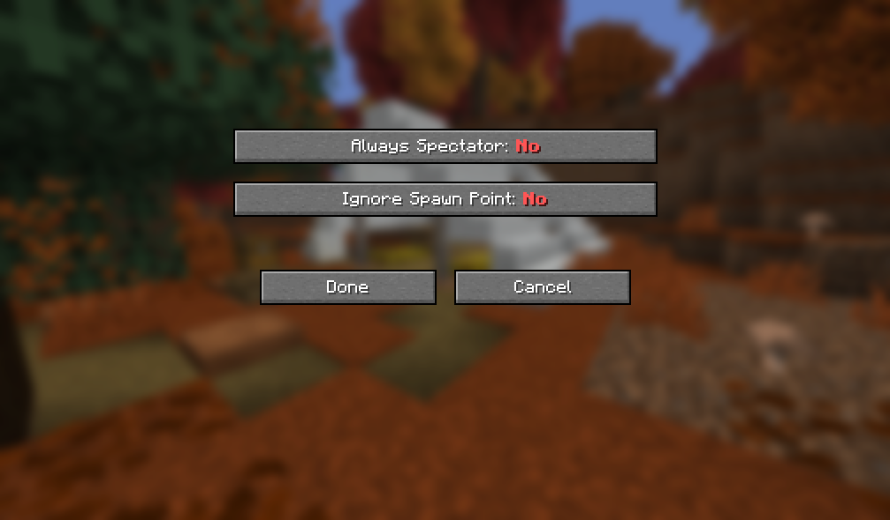

# Easy Spectator

  

  <strong>Automatically forces Spectator Mode upon death respawn.</strong> 
  Available for Minecraft 26.3 on Fabric & NeoForge.

  <strong>English</strong> | <a href="README.ja.md">日本語</a>

---

**Easy Spectator** is a lightweight Minecraft mod that automatically switches players to **Spectator Mode (`SPECTATOR`)** when they respawn after dying.

It is ideal for hardcore-style challenge runs, elimination SMP events, and mini-games without requiring administrative commands or manual intervention. The mod includes a clean, native in-game configuration screen requiring zero external configuration dependencies.

## 🌟 Features

- 👻 **Forced Spectator on Death Respawn**
  - Players automatically respawn in Spectator Mode when clicking the "Respawn" button after dying (`keepEverything == false`).
  - Does **not** trigger when returning through the End portal after defeating the Ender Dragon (`keepEverything == true`). Players can safely return home in Survival Mode.
- 📍 **Reset Personal Spawn Point to World Spawn**
  - Automatically clears personal bed / respawn anchor registrations on death, safely respawning the player at the Overworld initial world spawn.
  - Can be toggled off if you prefer players respawning at their registered bed or anchor as spectators.
- ⚙️ **Native In-Game Configuration Screen**
  - Built entirely using Minecraft's vanilla UI widgets—no heavy third-party libraries (such as Cloth Config) required.
  - Accessible directly via **ModMenu** on Fabric or the **Mods > Config** button on NeoForge.
  - Features high-visibility colored options (**Yes** in bold green, **No** in bold red).

## 📸 Screenshot

## ⚙️ Configuration Options

Settings can be modified via the in-game GUI or directly in `config/mc_easy_spectator.properties`:

| GUI Label | Config Key | Type | Default | Description |
| :--- | :--- | :--- | :--- | :--- |
| **Always Spectator** | `enabled` | `boolean` | `true` | **Yes**: Forces Spectator Mode on death respawn. **No**: Temporarily disables mod functionality. |
| **Ignore Spawn Point** | `ignoreSpawnPoint` | `boolean` | `true` | **Yes**: Clears personal bed/anchor spawn and respawns at world spawn. **No**: Keeps bed/anchor location as the respawn point. |

## 📥 Requirements & Installation

- **Minecraft Version**: 26.3
- **Supported Loaders**:
  - **Fabric**: Fabric Loader 0.19.3+ & Fabric API (ModMenu recommended for in-game settings GUI)
  - **NeoForge**: NeoForge 26.3.0.3-beta+
- **Environment**: Supports both Singleplayer and Dedicated Servers.
  - When installed on a dedicated server, all connected players will automatically be switched to spectator mode upon death.

## 📄 License

This project is licensed under the [MIT License](https://opensource.org/licenses/MIT).
